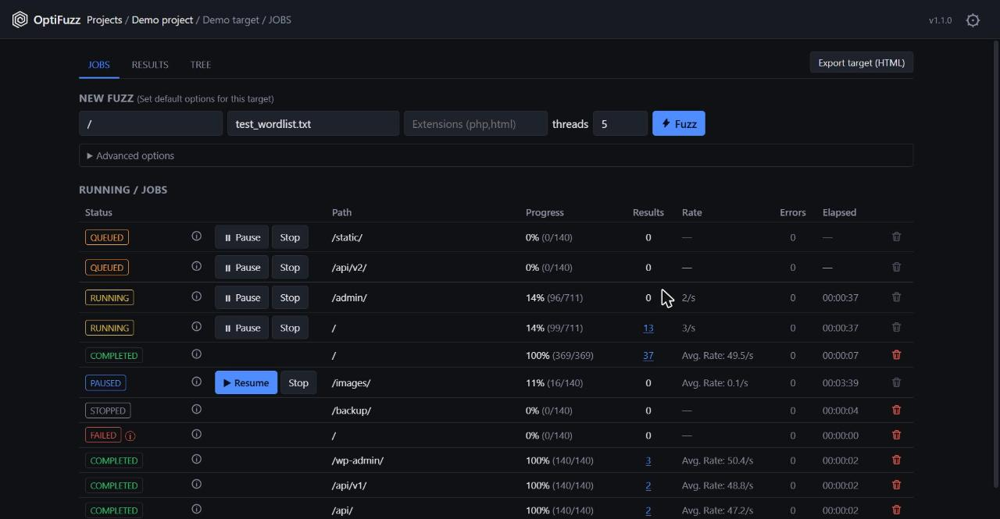
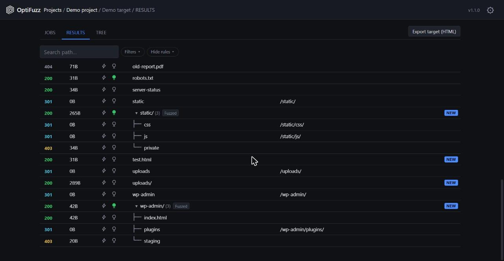
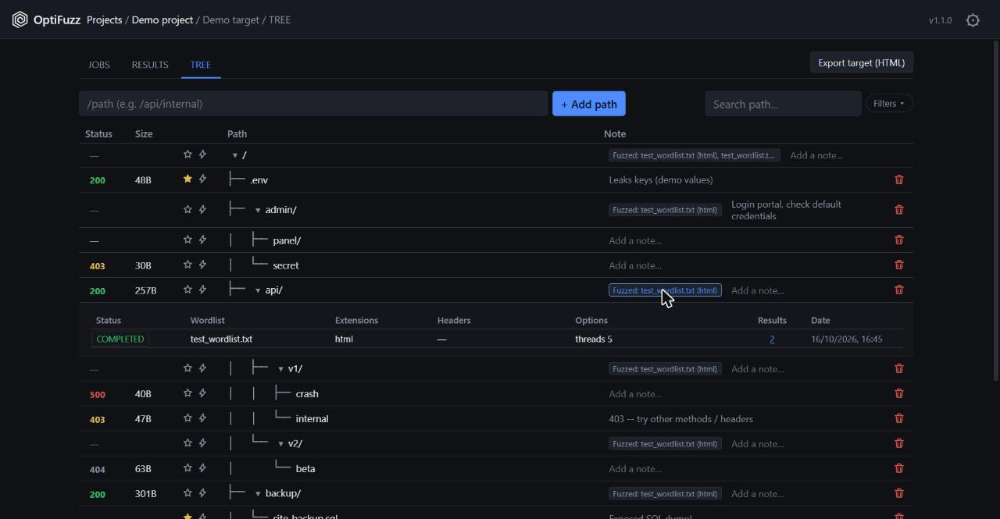

# OptiFuzz

**A local workspace for web content discovery.** OptiFuzz wraps [dirsearch](https://github.com/maurosoria/dirsearch)
in a desktop app that organises fuzzing by project and target, lets you pause and resume long runs,
and turns the raw output into a browsable, annotated map of what you have found.

It runs entirely on your machine, on **Windows and Linux**. Nothing is sent anywhere: no telemetry,
no cloud, and the app only listens on `127.0.0.1`. It only goes online when you ask it to check for
updates (see [Updating](#updating)).



> **Legal notice.** OptiFuzz is provided for educational purposes and for security testing of
> systems you own or have explicit authorisation to test. Using it against anything else may be
> illegal. The author accepts no responsibility for misuse. Read the full
> [legal disclaimer](#legal-disclaimer) before using it.

## Contents

- [Features](#features)
- [Installation](#installation)
- [Updating](#updating)
- [Quick start](#quick-start)
- [Trying it safely: the demo target](#trying-it-safely-the-demo-target)
- [Using OptiFuzz](#using-optifuzz)
- [Settings](#settings)
- [How it works](#how-it-works)
- [Development and tests](#development-and-tests)
- [Troubleshooting](#troubleshooting)
- [Credits](#credits)
- [Legal disclaimer](#legal-disclaimer)
- [License](#license)

## Features

**Organisation**
- One installation, many **projects**, each with several **targets** (hosts). Everything a target
  produces (jobs, results, tree, notes, reports) stays isolated from every other target.
- Per-target form defaults are remembered: wordlist, extensions, threads, headers and options.

**Fuzzing**
- Starts dirsearch jobs from a form: path, wordlist, extensions, threads, *force extensions*,
  extra headers, any other dirsearch flag as free text, and an optional *authenticated* tag that
  appends `__AUTH` to the file name of the job's raw dirsearch output (its `.txt` file), so
  authenticated runs are easy to tell apart.
- **Pause, Resume and Stop** at any time. A paused job resumes from where it stopped, not from the
  start, and progress is checkpointed regularly, so an app crash does not lose a long run: jobs
  that were running come back as paused.
- **Auto-pause on status codes** (for example `429` when a target is rate limiting you).
- A per-target limit on concurrent jobs, with a queue for the rest.
- Live progress (percentage, request rate, errors, elapsed time) for every running job.
- A **failed** job is not a **stopped** one: failures keep their reason, one click away.
- Every job keeps the exact options it ran with. dirsearch's own raw output for each job is kept on
  disk as a readable `.txt` file in the target's `outputs` folder.

**Results**
- Status codes colour-coded by class at a glance (1xx, 2xx, 3xx, 4xx, 5xx, with 401 and 403
  highlighted), size, and redirect destination.
- A **NEW** badge on everything you have not seen yet, so a re-run shows only what changed for you.
- Search, filters (status, size, parent path) and persistent **hide rules** to cut noise.
- One click to **fuzz deeper** from any result, or to open it in your browser of choice.



**FUZZ TREE** (the map you curate)
- The tree is yours: it is **not** filled automatically. Add paths by hand or promote results
  into it, so it contains what matters.
- Mark paths as **interesting**, attach **notes**, and see at a glance which paths have already
  been fuzzed, with which wordlists.
- Fuzz any node, with no automatic recursion: you decide what to explore next.



**Export**
- A single, self-contained **HTML report** for a target (tree, results, jobs). It opens offline with
  no backend and is **interactive**: search, filters and hide rules keep working inside the file.
- Export every target of a project at once, as a `.zip` of reports or one combined HTML page.
- Optionally mirror dirsearch's raw output (the `.txt` file of every job) into a folder of your
  choice, with one subfolder per target. It is a convenience copy, set per project in its
  *Outputs mirror* section; the original files stay where they are.

## Installation

You need **Git** and **Python 3.11 or newer** (dirsearch requires 3.11; OptiFuzz is tested on
3.11, 3.12 and 3.13). dirsearch is installed automatically from its GitHub repository as a pinned
dependency.

On Linux that means Ubuntu 24.04, Debian 12 or newer, Kali, Fedora or Arch. Ubuntu 22.04 ships
Python 3.10 and is not supported unless you install a newer Python yourself.

```bash
git clone https://github.com/R3DN3Tx/OptiFuzz.git
cd OptiFuzz
```

### Windows 10 / 11

The window uses WebView2, which ships with current Windows.

```powershell
powershell -ExecutionPolicy Bypass -File .\install.ps1
.\run.ps1
```

### Linux (Debian, Ubuntu, Kali and derivatives)

The window uses GTK 3 and WebKit2GTK 4.1 from your distribution.

```bash
./install.sh        # installs the system packages with sudo, then the virtual environment
./run.sh
```

`install.sh` installs everything the app needs: the window toolkit, `git`, the fonts for the icon
glyphs, and then the Python environment. It does the system part with `sudo` using your package
manager:

| Distribution | Packages it installs | Status |
|---|---|---|
| Debian, Ubuntu, Kali | `python3-venv python3-gi gir1.2-gtk-3.0 gir1.2-webkit2-4.1 git fonts-dejavu-core fonts-noto-core` | tested |
| Fedora | `python3 python3-gobject gtk3 webkit2gtk4.1 git dejavu-sans-fonts google-noto-sans-fonts` | not tested |
| Arch | `python python-gobject gtk3 webkit2gtk-4.1 git ttf-dejavu noto-fonts` | not tested |

On any other distribution, install the equivalents yourself (including the DejaVu and Noto fonts,
which provide the icon glyphs such as the gear and the pause symbol) and run `install.sh` again for
the Python part. If you would rather not use `sudo`, install those packages by hand first: the
script only installs what is missing.

### Manual installation

```bash
python3 -m venv --system-site-packages .venv      # Windows: python -m venv .venv
.venv/bin/pip install -r requirements.txt         # Windows: .venv\Scripts\pip ...
.venv/bin/python run_desktop.py                   # Windows: .venv\Scripts\pythonw.exe run_desktop.py
```

### Prefer a browser tab to a window?

The window is a thin shell around a local web app. You can also run it in your browser:

```bash
.venv/bin/python -m uvicorn backend.main:app --host 127.0.0.1 --port 8000
```

then open <http://127.0.0.1:8000>.

## Updating

Open **Settings -> Updates** and click *Check for updates*; if there is a newer version, *Update now*
downloads it and refreshes the dependencies, then you restart OptiFuzz. Running and queued jobs
are paused when you update (resume them afterwards). You do not need to download
the repository again, and your projects, targets, jobs and wordlists are kept (your data is stored
outside the program folder). It works on any copy installed with `git clone`; if you changed tracked
files yourself, it refuses to overwrite them.

The same thing by hand: `git pull`, then `.venv/bin/pip install -r requirements.txt`
(Windows: `.venv\Scripts\pip ...`).

## Quick start

1. Start OptiFuzz.
2. Create a **Project**, then add a **Target** with its base URL (for example `https://target.example`).
3. On the **JOBS** tab, enter a path (`/`), pick a wordlist, optionally add extensions
   (`php,html`) and click **Fuzz**.
4. Watch it run; open **RESULTS** when hits appear. Use the lightning icon on a result to fuzz
   inside it, or the tree icon (*Add to TREE*) to promote it to the **TREE**.
5. In the **TREE**, mark what looks interesting and write down why.
6. Click **Export target (HTML)** when you want a report.

The repository ships one example wordlist, `wordlists/test_wordlist.txt`. For real work, add your
own lists: they must be inside the `wordlists` folder of OptiFuzz for the app to be able to read
them. Then pick one in the wordlist picker and star your favourite as the default.

## Trying it safely: the demo target

`dev/demo-target/` is a tiny fake website that runs on `127.0.0.1:8910` and answers with a
variety of status codes (200, 301, 302, 403, 404, 500, among others) at several directory levels. It exists so you
can try every feature without touching a real system, and it is what the screenshots above were
taken against.

```bash
python dev/demo-target/demo_server.py
```

Create a target for `http://127.0.0.1:8910`, fuzz it with `test_wordlist.txt`, and follow the
guided walkthrough, including what each path returns and what to try (deeper fuzzing, pause and
resume, a failed job, the tree, the export), in
[`dev/demo-target/README.md`](dev/demo-target/README.md).

## Using OptiFuzz

**Choosing what to fuzz.** *Force extensions* makes dirsearch also try `word/` and
`word.<ext>` for every extension you list; without it, extensions are only appended to
wordlist lines that contain `%EXT%`. Any other dirsearch flag goes in *Advanced options -> Custom
options*, written exactly as on the dirsearch command line (for example
`--max-rate 50 --timeout 10`).

**Staying in control.** OptiFuzz is built for manual, step-by-step exploration: it never recurses
on its own. When a result looks worth exploring you start that fuzz yourself, from the result or
from the tree, so every request is a decision.

dirsearch has its own recursion flags (`-r`, `-R`, ...). You can pass them in *Custom options* and
the job runs and records everything it finds, including the nested paths. They are, however, not
officially supported: the progress counters, and Pause and Resume, are designed around a single
pass over the wordlist. With recursion the progress only reflects the first level, and a paused
job cannot restore dirsearch's internal recursion queue when it is resumed. For deeper levels,
prefer fuzzing from the tree.

**Long runs.** Pause before closing the app, or just close it: running jobs come back as paused
and resume from their last checkpoint. Several jobs can run at once (the limit is per target, in
*Advanced options*).

**Sharing findings.** *Export target (HTML)*, at the top right of a target, saves a single HTML
file with that target's jobs, results and tree. It has no dependencies, so you can open it anywhere,
offline, and it stays interactive: you can still search and use the filters and hide rules. On a
project's targets page, *Export all targets* has a small arrow to choose between two
formats:

- **`.zip`**: one separate HTML report per target, inside a zip file.
- **`.html`**: one single HTML file containing every target of the project, with navigation
  between them.

## Settings

The gear icon in the header opens:

| Setting | What it does |
|---|---|
| Browser for opening results | The browser launched when you open a result's URL (detected automatically; or a custom path) |
| Output filenames | The naming pattern of each job's raw dirsearch output file (`.txt`) |
| Desktop app port | A custom local port for the app to listen on, instead of the built-in default |
| Updates | Check for a newer version and update in place, keeping your projects |
| Default extensions | What dirsearch uses when *Force extensions* is on but no extensions were picked |

## How it works

- A **FastAPI** backend, bound to `127.0.0.1`, owns the data and runs dirsearch as a subprocess,
  one process per job, parsing its live output.
- A static web **frontend** (plain JavaScript and CSS, no build step) talks to it over HTTP and
  server-sent events for live updates.
- **pywebview** shows the frontend in a native window: WebView2 on Windows, GTK + WebKit2GTK on
  Linux.
- State is stored as JSON files plus dirsearch's untouched raw output (`.txt`), written atomically.

## Development and tests

```bash
.venv/bin/python -m pytest          # Windows: .venv\Scripts\python -m pytest
```

CI (`.github/workflows/ci.yml`) runs on every push, on Windows and Linux:

- Ubuntu 24.04 with the distribution's own Python (3.12) and the system GTK/WebKit packages: the
  full test suite, an end-to-end check against real dirsearch (`dev/ci_e2e.py`: complete run,
  Pause, Resume, Stop, a failed job) and a smoke test that starts the real desktop window under a
  virtual display (`dev/ci_smoke.py`), which also checks the window actually painted.
- Linux with Python 3.11 (the minimum) and 3.13, and Windows with Python 3.13: the suite plus the
  end-to-end check.

## Troubleshooting

- **Linux under WSL (WSLg).** Rendering is done in software, so scrolling long result lists can
  stutter. This comes from WSLg itself; a native Linux desktop with a GPU is expected to be much
  smoother (not verified).
  The window zooms automatically to match your Windows display scaling; set
  `OPTIFUZZ_UI_SCALE` (for example `1.25`) to override it.
- **"Open in browser" does nothing.** Pick a browser in *Settings -> Browser for opening results*.
- **The window does not open.** Start it from a terminal to see errors:
  `.venv/bin/python run_desktop.py`.

## Credits

- [dirsearch](https://github.com/maurosoria/dirsearch) does the actual fuzzing. OptiFuzz does
  not bundle it; it is installed from its own repository and run as a separate process.
- [pywebview](https://pywebview.flowrl.com), [FastAPI](https://fastapi.tiangolo.com) and
  [uvicorn](https://www.uvicorn.org) for the application shell.
- Fonts bundled for Linux (SIL Open Font License 1.1): **Selawik** and **Cascadia Mono**, both by
  Microsoft. See [`frontend/fonts/`](frontend/fonts/).

## Legal disclaimer

OptiFuzz is a web content-discovery tool intended for **learning, research and authorised
security assessments**: your own systems, lab and CTF environments, and engagements where the
owner has given you explicit permission (ideally in writing, with a defined scope).

- Sending requests to a system you do not have permission to test can be a crime in many
  jurisdictions, under computer-misuse and cybercrime laws, whatever your intentions. Get
  permission first.
- You alone are responsible for how you use this software and for complying with every applicable
  law, contract, and the rules of any platform, bug-bounty programme or client engagement you work
  under.
- The author and contributors accept **no responsibility or liability** for any damage, data loss,
  service disruption, legal consequence or other harm resulting from the use or misuse of this
  software.
- Fuzzing sends a large number of requests and can degrade or take down a fragile target. Use the
  thread, rate and delay options, and test only when you are allowed to.
- The software is provided "as is", without warranty of any kind, express or implied (see
  sections 15 to 17 of the [license](LICENSE)).
- Nothing in this repository is legal advice.

By using OptiFuzz you accept these terms.

## License

OptiFuzz is free software, released under the **GNU General Public License, version 3**
([LICENSE](LICENSE)). Copyright (C) 2026 R3DN3Tx.

In plain words: you may use, study, modify and share it. If you distribute it, modified or not,
or distribute a program that contains OptiFuzz code, you must keep the copyright and license
notices and make the complete corresponding source code available under the same license. It
cannot be turned into closed-source software.

Third-party components keep their own licenses: the bundled fonts are under the SIL Open Font
License 1.1 (texts in [`frontend/fonts/`](frontend/fonts/)), and dirsearch is a separate program
under its own license, installed from its repository and not redistributed here.
